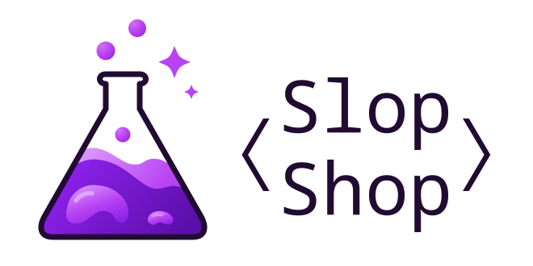

  <picture>
    <source media="(prefers-color-scheme: dark)" srcset="https://raw.githubusercontent.com/slop-shop-dev/.github/main/profile/assets/slop-shop-primary-on-dark.svg">
    <source media="(prefers-color-scheme: light)" srcset="https://raw.githubusercontent.com/slop-shop-dev/.github/main/profile/assets/slop-shop-primary-on-light.svg">
    
  </picture>

## Welcome to the workshop

Rough ideas, working code, one experiment at a time. Welcome to Slop Shop.

Slop Shop is Rui's home for software projects and AI experiments, based in Portugal.
It is a place to explore ideas, build useful tools and learn by making things.

For now, the focus is experimentation: giving promising ideas room to develop into software worth sharing.
Over time, that work may grow into a software and AI consultancy.

Browse our public repositories to see what we share along the way.

[slop-shop.dev](https://slop-shop.dev)
